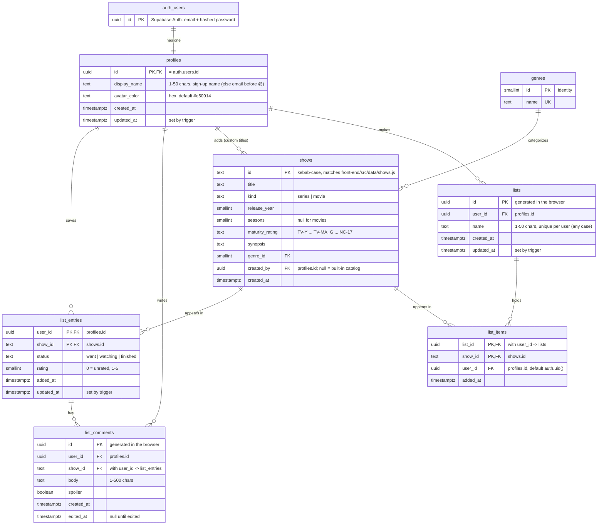

# Database schema

Supabase (Postgres) schema for Myflix. The whole database is in [`supabase/schema.sql`](../supabase/schema.sql), and step by step in [`supabase/migrations/`](../supabase/migrations/); this page explains it.

**Authentication (since 2026-10-19):** users register and log in with email + password (Supabase Auth). The browser sends the user's access token with every request, the database reads who they are with `auth.uid()`, and Row Level Security shows each user only their own rows. Visitors who aren't logged in (`anon`) can't read or write any table. GitHub renders the diagram below; in VS Code, use a Mermaid preview extension, or open **Supabase → Database → Schema Visualizer**.

## Entity-relationship diagram

## Tables

Every policy is `to authenticated` (logged-in users). Every `user_id` is `not null default auth.uid()` with `on delete cascade`, so the app never sends a user id.

| Table | One row per | Who can access it (RLS) |
|---|---|---|
| `profiles` | user account; created automatically on sign-up by the `on_auth_user_created` trigger | Owner reads and updates their own row |
| `genres` | genre | Logged-in users read; no writes from the browser |
| `shows` | title: the built-in catalog (mirrors `front-end/src/data/shows.js`, `created_by` null) plus titles users add themselves | Logged-in users read the catalog; a user's own titles are visible to and editable by only them |
| `list_entries` | show a user saved to My List | Owner only (`auth.uid() = user_id`), and only shows they can see |
| `list_comments` | comment a user left on a saved show | Owner only (`auth.uid() = user_id`) |
| `lists` | named list a user made ("Comfort shows") | Owner only (`auth.uid() = user_id`) |
| `list_items` | title in one of those lists | Owner only (`auth.uid() = user_id`), and only shows they can see |

## Relationships and rules

- **auth.users → profiles (1:1)**: deleting an account deletes its profile, and everything below cascades from it.
- **profiles → list_entries / list_comments (1:N)**: `on delete cascade`.
- **list_entries → list_comments (1:N)**: comments reference `(user_id, show_id)`; removing a show from My List deletes its comments.
- **shows → list_entries (1:N)**: a list row must point at a real catalog show. Adding a show to `front-end/src/data/shows.js` also needs an insert in a new migration.
- **genres → shows (1:N)**: each show has one genre.
- **profiles → shows (1:N, custom titles)**: `created_by` marks a title a user added. Deleting the title cascades to its My List row, comments and list items.
- **profiles → lists → list_items (1:N:N)**: deleting a list deletes its items. `list_items` points at `lists (id, user_id)`, so an item can only go in its owner's list.
- **shows → list_items (1:N)**: the same title can be in many lists.
- `updated_at` columns are maintained by the `set_updated_at()` trigger.

## How the app maps to it

`front-end/src/lib/auth.js` is the only file that calls Supabase Auth (register, log in, log out, load the profile). The name typed at Register goes into the account's metadata, and the trigger copies it into `profiles.display_name`.

`front-end/src/lib/listSync.js` converts between reducer state and rows: `entryToRow` / `commentToRow` going up, `rowsToState` coming down. It reads and writes `list_entries` and `list_comments`. Rows going up never include `user_id`.

`front-end/src/lib/librarySync.js` does the same for the library: `showToRow` / `listToRow` / `itemToRow` going up, `rowsToLibrary` coming down. It reads and writes the user's own `shows` rows, `lists` and `list_items`, and reads `genres` to turn genre names into ids. Built-in show details on screen still come from `front-end/src/data/shows.js`.

## Migrations

| File | Adds |
|---|---|
| `20261016000000_my_list.sql` | `list_entries`, `list_comments`, RLS policies |
| `20261016190000_profiles_catalog.sql` | `profiles` (+ sign-up trigger), `genres`, `shows` (+ seed), foreign keys, `updated_at` triggers |
| `20261018000000_custom_shows_and_lists.sql` | `shows.created_by` + RLS for user-added titles, `lists`, `list_items`, cascade from shows to `list_entries` |
| `20261019204059_reset_for_auth.sql` | Drops everything above and the old anonymous accounts (rows backed up in `supabase/backups/`) |
| `20261019204115_auth_profiles.sql` | Step 1: `profiles` as the authentication table + `on_auth_user_created` trigger |
| `20261019204211_auth_tables.sql` | Step 2: the other six tables, empty, RLS on, catalog seed |
| `20261019204234_auth_rls_policies.sql` | Step 3: table privileges + 17 owner-only RLS policies (`to authenticated`) |

To set up a fresh Supabase project, paste `supabase/schema.sql` into the SQL Editor and Run (it equals the last three migrations). Then in **Authentication → Sign In / Providers**: Email on, and for development **Confirm email** off.
