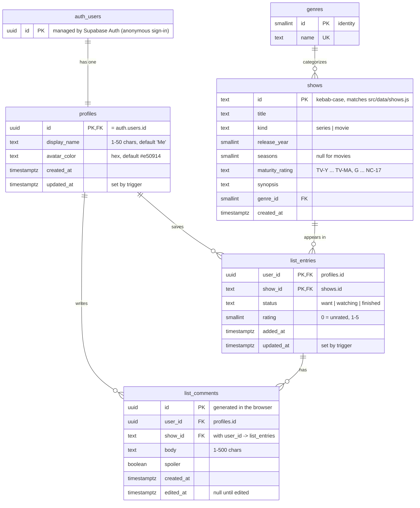

# Database schema

Supabase (Postgres) schema for Myflix. The source of truth is the SQL in [`supabase/migrations/`](../supabase/migrations/); this page explains it. GitHub renders the diagram below; in VS Code, use a Mermaid preview extension, or open **Supabase → Database → Schema Visualizer**.

## Entity-relationship diagram

## Tables

| Table | One row per | Who can access it (RLS) |
|---|---|---|
| `profiles` | user account; created automatically on sign-up by the `on_auth_user_created` trigger | Owner reads and updates their own row |
| `genres` | genre | Everyone reads; no writes from the browser |
| `shows` | title in the catalog (mirrors `src/data/shows.js`) | Everyone reads; no writes from the browser |
| `list_entries` | show a user saved to My List | Owner only (`auth.uid() = user_id`) |
| `list_comments` | comment a user left on a saved show | Owner only (`auth.uid() = user_id`) |

## Relationships and rules

- **auth.users → profiles (1:1)**: deleting an account deletes its profile, and everything below cascades from it.
- **profiles → list_entries / list_comments (1:N)**: `on delete cascade`.
- **list_entries → list_comments (1:N)**: comments reference `(user_id, show_id)`; removing a show from My List deletes its comments.
- **shows → list_entries (1:N)**: a list row must point at a real catalog show. Adding a show to `src/data/shows.js` also needs an insert in a new migration.
- **genres → shows (1:N)**: each show has one genre.
- `updated_at` columns are maintained by the `set_updated_at()` trigger.

## How the app maps to it

`src/lib/listSync.js` converts between reducer state and rows: `entryToRow` / `commentToRow` going up, `rowsToState` coming down. The app reads and writes only `list_entries` and `list_comments`; show details on screen still come from `src/data/shows.js`.

## Migrations

| File | Adds |
|---|---|
| `20261016000000_my_list.sql` | `list_entries`, `list_comments`, RLS policies |
| `20261016190000_profiles_catalog.sql` | `profiles` (+ sign-up trigger), `genres`, `shows` (+ seed), foreign keys, `updated_at` triggers |

To set up a fresh Supabase project, run them in order in the SQL Editor, or with the Supabase CLI: `supabase db push`.
